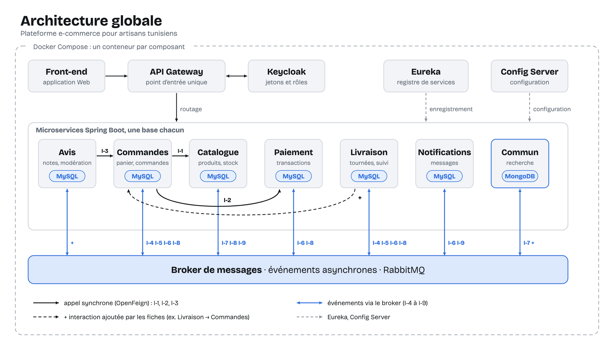

# E-commerce
# Plateforme e-commerce pour artisans tunisiens

Mini-projet AWD (Applications Web Distribuées), ESPRIT, année 2026-2027. Architecture microservices.

> Les sections marquées **À compléter** attendent des informations que seule l'équipe connaît (noms, liens, commande Docker finale).

## Sujet

Les artisans tunisiens n'ont pas de vitrine en ligne simple pour vendre leurs produits. La plateforme relie les artisans, les clients et les livreurs : l'artisan publie ses produits, le client commande et paie, le livreur achemine la commande, et chacun est informé à chaque étape.

- **Acteurs :** client, artisan (vendeur), livreur, administrateur,Fournisseur
- **Fonctionnalités principales :** publier et gérer des produits, parcourir et rechercher, passer commande, payer (paiement simulé), suivre la livraison, recevoir des notifications, laisser un avis , gerer le stock.

## Équipe


| Microservice | Responsable | Base |
|---|---|---|
| Catalogue | Moetez Ben Attia | MySQL |
| Commandes | Dhia Arfaoui | MySQL |
| Paiement | Tasnim Tlili | MySQL |
| Livraison | Houssem Kanzari | MySQL |
| Notifications | Salim Ben Chaabene | MySQL |
| Avis | Firas Ncibi | MySQL |
| Service commun (recherche, recommandations) | Groupe | MongoDB |

## Architecture

Front-end, API Gateway (Spring Cloud Gateway), Keycloak, Eureka, Config Server, 7 microservices Spring Boot avec une base chacun (aucune base partagée), broker de messages (RabbitMQ), le tout dans Docker Compose.



### Interactions entre microservices

| Code | Interaction | Mode |
|---|---|---|
| I-1 | Commandes → Catalogue (vérifier et réserver le stock) | Synchrone (OpenFeign) |
| I-2 | Commandes → Paiement (déclencher le paiement) | Synchrone (OpenFeign) |
| I-3 | Avis → Commandes (vérifier qu'un achat existe) | Synchrone (OpenFeign) |
| I-4 | Commande payée | Asynchrone (broker) |
| I-5 | Livraison terminée | Asynchrone (broker) |
| I-6 | Notifications (e-mail, SMS) | Asynchrone (broker) |
| I-7 | Événements produit vers le service commun | Asynchrone (broker) |
| I-8 | Commande annulée | Asynchrone (broker) |
| I-9 | Stock bas | Asynchrone (broker) |

Détail des données, du mode de chaque interaction et de sa justification : [E3 et E4](Documentation/E3-E4-donnees-communication-architecture.md).

## Structure du dépôt

```
Backend/                      un projet par microservice
  catalogue-service/
Frontend/                     application Web
Documentation/
  Diagrams/                   schémas : architecture, API REST (endpoints/), interactions (interactions/)
  Presentation/               supports de présentation
  catalogue/                  fiches de conception (Catalogue, service commun)
  equipe/                     documents d'équipe E1 à E4
  Sources/                    documents de cadrage reçus
README.md
```

## Lancement

### Catalogue (seul service créé pour l'instant)

Prérequis : Java 17 ou plus. Maven n'est pas à installer, le wrapper `mvnw` est fourni.

```bash
cd Backend/catalogue-service
./mvnw spring-boot:run
```

Vérifier : `http://localhost:8081/actuator/health` répond `{"status":"UP"}`. Documentation de l'API : `http://localhost:8081/swagger-ui.html`.


## Suivi des tâches

**À compléter** : lien vers l'outil de gestion de projet de l'équipe (Trello, Jira, GitHub Projects…).
