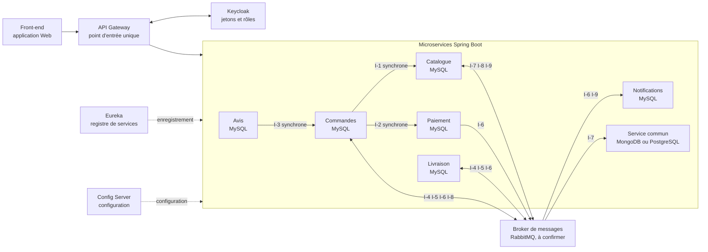

# Architecture cible

Critère E4. Détail des composants, des interactions (I-1 à I-9) et des points à confirmer :
[E3-E4-donnees-communication-architecture.md](../E3-E4-donnees-communication-architecture.md).
Version dessinée (pour la présentation) : document Docs « E3 et E4 — Données, communication et architecture », section 4.

**Lecture.** Trait plein entre services : appel synchrone (OpenFeign). Flèche vers le broker : le service publie un événement. Flèche depuis le broker : il le consomme. Tout tourne dans Docker Compose, avec un conteneur par composant.
