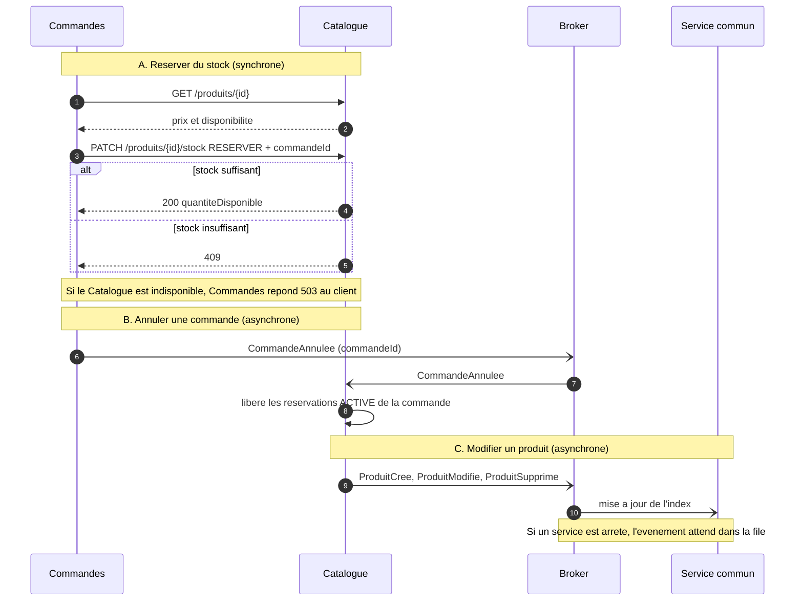

# Catalogue : interactions (I2)

Fiche de conception : [fiche-conception.md](../catalogue/fiche-conception.md).

Le Catalogue **n'appelle aucun service en synchrone** : la panne d'un autre service ne peut donc pas le bloquer.
Il est appelé par Commandes, et il publie ou consomme des événements pour le reste.

## 1. Tableau des interactions

| Code | Avec | Sens | Mode | Données échangées | Justification | Si le service en face est en panne |
|---|---|---|---|---|---|---|
| I-1 | Commandes | Commandes appelle le Catalogue | Synchrone (OpenFeign) | `GET /produits/{id}` : prix, disponibilité. `PATCH …/stock` `RESERVER` : produitId, quantité, commandeId | La commande a besoin de la réponse tout de suite pour accepter ou refuser. La vérification et la réservation sont un seul appel | **Catalogue indisponible :** Commandes refuse avec une réponse claire (503), après un nouvel essai ou via un circuit breaker, plutôt que de risquer une survente |
| I-7 | Service commun (recherche) | Le Catalogue publie | Asynchrone | `ProduitCréé`, `ProduitModifié`, `ProduitSupprimé` | L'indexation n'est pas urgente et ne doit pas ralentir le Catalogue | **Service commun indisponible :** le Catalogue continue ; les événements attendent dans la file et sont traités au retour |
| I-8 | Commandes | Le Catalogue consomme | Asynchrone | `CommandeAnnulée` : commandeId | Libérer le stock sans bloquer l'annulation | **Commandes indisponible :** sans effet pour le Catalogue ; l'événement attend dans la file |
| I-9 | Notifications | Le Catalogue publie | Asynchrone | `StockBas` : produitId, artisanId, quantité, seuil | Prévenir l'artisan sans bloquer la vente. C'est ce qui donne un rôle au seuil d'alerte | **Notifications indisponible :** la vente n'est pas affectée ; l'alerte part au retour |

> **I-9 est à confirmer en équipe** : l'événement `StockBas` n'est pas encore dans le tableau de l'équipe. Les codes I-1, I-7 et I-8 suivent ce tableau.

## 2. Autres pannes

| Panne | Comportement |
|---|---|
| **Broker de messages indisponible** | Les modifications du Catalogue restent enregistrées. Les événements sont gardés dans la table technique `EVENEMENT_SORTANT` et publiés plus tard, au retour du broker |
| **Base de données indisponible** | Le Catalogue répond **503**. Commandes applique la même règle que pour I-1 |
| **Keycloak et Eureka** | Ils ne sont **pas appelés à chaque requête métier** : le Catalogue vérifie le jeton avec la clé de Keycloak et s'enregistre dans Eureka au démarrage |

## 3. Schéma de séquence

Lecture : le trait plein avec `->>` est un appel synchrone, le pointillé `-->>` une réponse, et `-)` un événement envoyé sans attendre de réponse.

## 4. Qui parle à qui, en une phrase

- **Synchrone (I-1)** parce que Commandes ne peut pas continuer sans savoir si le stock est suffisant.
- **Asynchrone (I-7, I-8, I-9)** parce que l'action peut attendre et qu'une panne de l'autre service ne doit pas bloquer le Catalogue.
