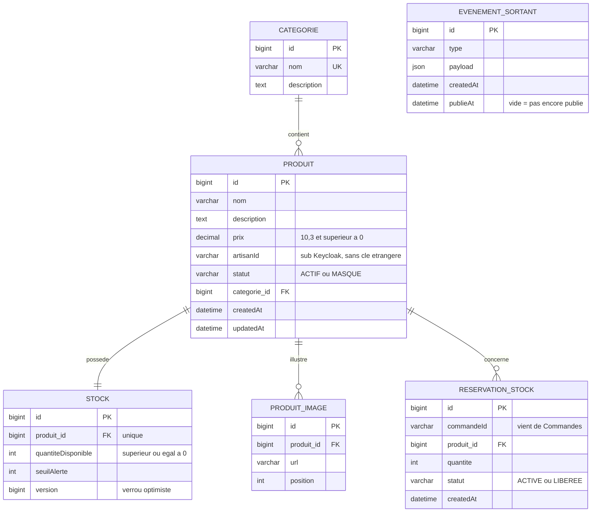

# Catalogue : modèle de données

Fiche de conception : [fiche-conception.md](../catalogue/fiche-conception.md) (section 5).

Le Produit est au centre : il appartient à une Catégorie et possède un Stock, des images et des réservations de stock.
`EVENEMENT_SORTANT` est une table technique, hors des 5 entités métier.

## Contraintes à retenir

- `RESERVATION_STOCK` : unique sur (`commandeId`, `produit_id`). C'est ce qui rend la réservation et la libération **idempotentes**.
- `STOCK.quantiteDisponible` ne peut jamais être négative (contrainte CHECK).
- `PRODUIT.artisanId` n'a **pas** de clé étrangère : l'artisan appartient à Keycloak.
- `EVENEMENT_SORTANT` est écrite dans la **même transaction** que la modification du produit ou du stock.
